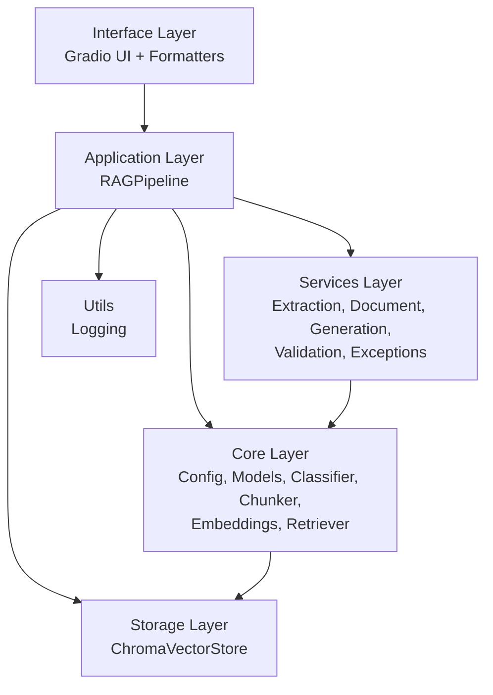

# Advanced AI-Powered Document Insights & Data Extraction (RAG Pipeline)

A modular Retrieval-Augmented Generation (RAG) application for PDF document ingestion, hybrid retrieval, and grounded question answering. This repository preserves the original notebook-based pipeline (`Final_Pipeline_Report.ipynb`) and refactors it into a structured MCA mini project with a `src` package layout, Gradio interface, persistent ChromaDB storage, and automated tests.

**Repository:** https://github.com/AnshulGhildiyal/RAG-Document-Extraction-Pipeline

## Project Overview
The system processes PDF documents and enables users to ask questions over extracted content. It combines:
- **PDF extraction:** Docling (primary) with pypdf fallback
- **Rule-based classification:** Resume, Invoice, Payslip, Contract, Financial statement, Report, General
- **Chunking:** Configurable, boundary-aware chunking (default 800 chars, 150 overlap) with metadata preservation
- **Embeddings:** SentenceTransformers `all-MiniLM-L6-v2`
- **Vector storage:** Persistent ChromaDB (`get_or_create_collection`, no startup deletion)
- **Retrieval:** Dense vector search + sparse TF-IDF search fused with weighted Reciprocal Rank Fusion (RRF)
- **Generation:** Google Gemini via `google-genai` (default `gemini-2.5-flash`) with grounded prompting and source references
- **UI:** Gradio interface for upload, Q&A, and database management

## Features
- PDF upload and processing with validation and user-friendly error messages
- Per-page extraction/classification and metadata-preserving chunk storage
- Hybrid retrieval (vector + TF-IDF) with configurable top-k and weighted RRF
- Grounded answer generation with retrieved source references/citations
- Persistent ChromaDB database with statistics, refresh, and explicit clear confirmation
- Centralized configuration (`.env`), logging, and custom exception handling
- Automated pytest suite (mocked external/expensive dependencies; no real API key required)

## Tech Stack
- **Language:** Python 3.10+
- **UI:** Gradio
- **LLM:** Google Gemini (`google-genai`)
- **Embeddings:** SentenceTransformers (`all-MiniLM-L6-v2`)
- **Vector DB:** ChromaDB
- **Retrieval:** scikit-learn TF-IDF + cosine similarity, weighted RRF fusion
- **PDF parsing:** Docling, pypdf
- **Config/Testing:** python-dotenv, pytest

## Architecture



For detailed design, data flows, and algorithm notes, see [docs/ARCHITECTURE.md](docs/ARCHITECTURE.md).

## Directory Structure

```text
RAG-Document-Extraction-Pipeline/
├── src/
│   └── rag_pipeline/
│       ├── __init__.py
│       ├── main.py
│       ├── core/
│       │   ├── __init__.py
│       │   ├── config.py
│       │   ├── models.py
│       │   ├── classifier.py
│       │   ├── chunker.py
│       │   ├── embeddings.py
│       │   ├── retriever.py
│       │   └── pipeline.py
│       ├── services/
│       │   ├── __init__.py
│       │   ├── document_service.py
│       │   ├── extraction_service.py
│       │   ├── generation_service.py
│       │   ├── validation.py
│       │   └── exceptions.py
│       ├── storage/
│       │   ├── __init__.py
│       │   └── vector_store.py
│       ├── interface/
│       │   ├── __init__.py
│       │   ├── gradio_app.py
│       │   └── formatters.py
│       └── utils/
│           ├── __init__.py
│           └── logger.py
├── tests/
│   ├── conftest.py
│   ├── test_classifier.py
│   ├── test_chunker.py
│   ├── test_retriever.py
│   ├── test_validation.py
│   ├── test_storage.py
│   └── test_pipeline.py
├── docs/
│   ├── PROJECT_REPORT.md
│   ├── ARCHITECTURE.md
│   ├── TEAM_CONTRIBUTIONS.md
│   └── VIVA_PREPARATION.md
├── sample_data/
│   └── README.md
├── data/
│   └── .gitkeep
├── logs/
│   └── .gitkeep
├── .env.example
├── .gitignore
├── pyproject.toml
├── requirements.txt
├── run.py
├── Final_Pipeline_Report.ipynb        # Original notebook (preserved)
└── Final Pipeline Presentation.pdf    # Original presentation (preserved)
```

## Installation

### Prerequisites
- Python 3.10 or newer
- `pip`
- (Optional but recommended) a virtual environment
- A Google Gemini API key for answer generation (`GEMINI_API_KEY`)

### 1. Clone the repository
```bash
git clone https://github.com/AnshulGhildiyal/RAG-Document-Extraction-Pipeline.git
cd RAG-Document-Extraction-Pipeline
```

### 2. Create and activate a virtual environment

#### Windows (PowerShell)
```powershell
python -m venv .venv
.venv\Scripts\Activate.ps1
```

#### Windows (Command Prompt)
```cmd
python -m venv .venv
.venv\Scripts\activate.bat
```

#### Linux / macOS (bash/zsh)
```bash
python3 -m venv .venv
source .venv/bin/activate
```

### 3. Install dependencies
```bash
pip install -r requirements.txt
```

(For development/testing tools declared in `pyproject.toml`, you can also install editable mode where supported: `pip install -e .`)

## API Key Configuration
1. Copy the example environment file:
   - **Windows (PowerShell):** `Copy-Item .env.example .env`
   - **Windows (CMD):** `copy .env.example .env`
   - **Linux/macOS:** `cp .env.example .env`
2. Open `.env` and set your Gemini API key:
   ```env
   GEMINI_API_KEY=your_api_key_here
   ```
3. Optional settings in `.env` include model names, chunking/retrieval parameters, ChromaDB path, and logging options (see `.env.example`).

> **Security:** Never commit `.env` or API keys to source control.

## Running the Application
Launch the Gradio app with:

```bash
python run.py
```

The application initializes the pipeline from environment configuration and starts the Gradio interface (default server settings are defined in the app launcher). If required dependencies/models are not installed yet, install them first via `requirements.txt`.

## Usage

### Uploading PDFs
1. Open the **Document Upload** tab.
2. Select a PDF file and click **Process document**.
3. Review the ingestion status (document type, pages, chunks, database totals).

### Asking questions
1. Open the **Question Answering** tab.
2. Enter a question about uploaded document(s).
3. Choose whether to use **hybrid retrieval** (vector + TF-IDF with RRF).
4. Click **Ask** to view the answer, source references, and retrieval details.

### Database management
- Open **Database Management** to view collection statistics.
- Use **Refresh statistics** to reload current counts.
- Use **Clear database** with explicit confirmation to remove stored chunks.

## Running Tests
Run the automated test suite from the repository root:

```bash
pytest
```

Or explicitly:

```bash
python -m pytest -q
```

Notes:
- Tests use mocks/temporary data and do not require a real `GEMINI_API_KEY` or internet access.
- `tests/test_storage.py` is skipped automatically if `chromadb` is not installed in the environment.

## Team Members

- Anshul
- Ravi
- Sarthak
- Jivika

## Documentation
- [docs/PROJECT_REPORT.md](docs/PROJECT_REPORT.md) — MCA project report
- [docs/ARCHITECTURE.md](docs/ARCHITECTURE.md) — architecture and design details
- [docs/TEAM_CONTRIBUTIONS.md](docs/TEAM_CONTRIBUTIONS.md) — team members
- [docs/VIVA_PREPARATION.md](docs/VIVA_PREPARATION.md) — viva questions and answers

## Limitations
- OCR is not claimed as a verified feature of the configured extraction path; scanned/image-only PDFs may not yield usable text.
- Answer generation requires a valid `GEMINI_API_KEY`, network access, and available Gemini API quota.
- End-to-end runtime behavior depends on local installation of required dependencies (e.g., Docling, ChromaDB, SentenceTransformers, Gradio).
- No quantitative accuracy/latency benchmarks are included; results depend on document quality and retrieval/generation behavior.

## Future Improvements
- Add OCR support and evaluation for scanned PDFs
- Add retrieval/answer quality evaluation datasets and metrics
- Improve incremental indexing and performance for large document collections
- Add authentication/multi-user isolation and richer document management
- Support additional formats and structured extraction (tables/forms/figures)

## Preserved Original Artifacts
- `Final_Pipeline_Report.ipynb` (original notebook)
- `Final Pipeline Presentation.pdf` (original presentation)
