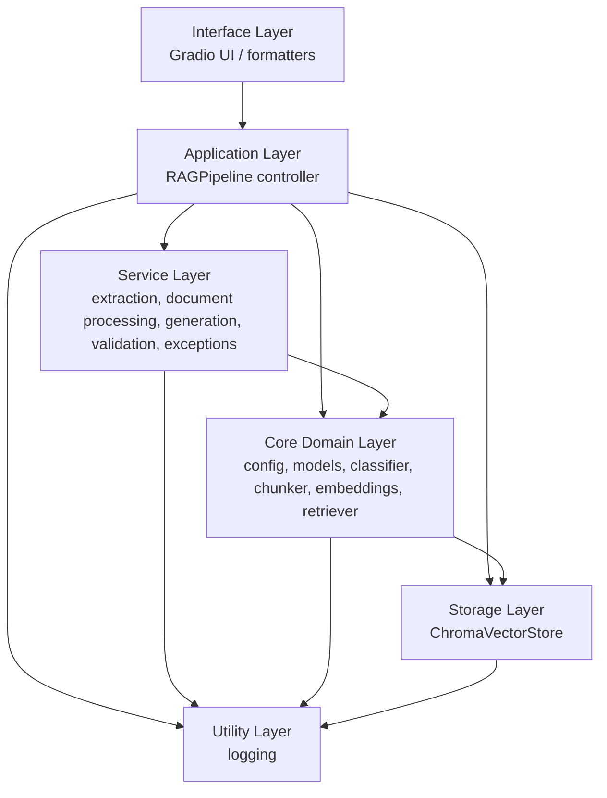
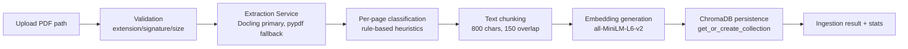
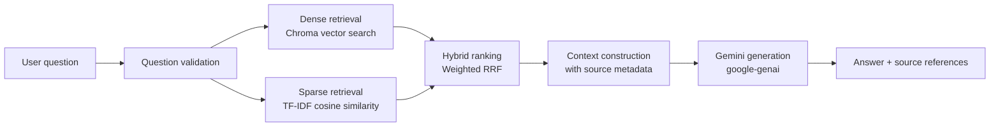

# Architecture

## 1. Overview
This project implements a modular Retrieval-Augmented Generation (RAG) pipeline for PDF document ingestion and question answering. The implementation preserves the original notebook's core capabilities (Docling extraction with fallback, rule-based classification, chunking, SentenceTransformer embeddings, ChromaDB storage, dense + TF-IDF retrieval, hybrid ranking, Gemini answer generation, and Gradio UI) while refactoring them into a layered `src` package.

## 2. Layered Architecture

### Layers and responsibilities
- **Interface (`src/rag_pipeline/interface/`)**: Gradio UI composition, user input collection, backend callbacks, and presentation formatting. No direct PDF parsing or retrieval algorithm implementation.
- **Application/Core orchestration (`src/rag_pipeline/core/pipeline.py`)**: `RAGPipeline` coordinates ingestion and QA workflows using injected/configured components.
- **Core (`src/rag_pipeline/core/`)**: Configuration, typed models, deterministic classification, chunking, embedding abstraction, retrieval/ranking logic.
- **Services (`src/rag_pipeline/services/`)**: PDF extraction (Docling + pypdf fallback), document processing/preparation, Gemini generation integration, validation, and custom exceptions.
- **Storage (`src/rag_pipeline/storage/`)**: Persistent ChromaDB collection management (insert/query/stats/delete/clear).
- **Utilities (`src/rag_pipeline/utils/`)**: Centralized logging configuration.

## 3. Module Dependencies (High Level)
- `interface.gradio_app` → `core.pipeline`, `interface.formatters`, `services.exceptions`
- `core.pipeline` → `core.config/models/classifier/chunker/embeddings/retriever`, `services.*`, `storage.vector_store`, `utils.logger`
- `services.document_service` → `services.extraction_service`, `core.classifier`, `core.chunker`, `core.models`
- `services.extraction_service` → `core.classifier`, `core.models`, `services.validation`
- `core.retriever` → `core.embeddings`, `core.models`, `storage.vector_store` (and lazy `sklearn` for sparse retrieval)
- `core.embeddings` → `sentence-transformers` (lazy load)
- `storage.vector_store` → `chromadb` (lazy client initialization)
- `services.generation_service` → `google-genai` client (lazy initialization)

## 4. Main Execution Flows

### 4.1 Document ingestion

### 4.2 Question answering

## 5. Class Responsibilities (Key Components)

| Component | Responsibility |
|---|---|
| `RAGConfig` | Centralized defaults, env loading, validation, path/key access |
| `ExtractedPage`, `Document`, `DocumentChunk`, `RetrievalResult`, `IngestionResult`, `QuestionAnswerResult` | Typed data contracts across layers |
| `DocumentClassifier` | Deterministic rule-based page/document type classification |
| `TextChunker` | Boundary-aware chunking with overlap, metadata preservation, stable IDs |
| `EmbeddingEngine` | Lazy SentenceTransformer loading, batch encoding, normalization |
| `ChromaVectorStore` | Persistent ChromaDB collection lifecycle, insert/query/delete/clear/stats |
| `HybridRetriever` | Dense search, sparse TF-IDF search, weighted RRF fusion, deduplication |
| `PDFExtractionService` | PDF validation integration, Docling parsing, pypdf fallback, page structuring |
| `DocumentService` | Document ID creation and extraction-to-chunk processing pipeline |
| `GenerationService` | Prompt construction, Gemini API calls/retries, grounded answer/citation packaging |
| `RAGPipeline` | End-to-end ingestion and QA orchestration with dependency injection |
| `GradioApp` | UI tabs/callbacks for upload, QA, database management, and status display |

## 6. Storage Design
- **Engine:** ChromaDB persistent client (`PersistentClient`)
- **Collection strategy:** `get_or_create_collection(...)` on access; **no automatic deletion on startup**
- **Persist path:** configurable (`./data/chroma_db` by default)
- **Stored fields:** chunk IDs, chunk text documents, embeddings, and metadata (document ID/filename/source path/page/chunk index/doc type/char count and extras as strings/primitives)
- **Operations:** add/upsert-safe insertion (skip existing IDs when detectable), vector query, count, get-all for sparse index/stats, delete by document, explicit clear
- **Consistency:** ingestion removes existing chunks for the same document ID before re-inserting newly processed chunks and invalidates sparse index cache

## 7. Retrieval Algorithm

### Dense retrieval
- Query embedding generated via `EmbeddingEngine`
- ChromaDB similarity query returns nearest chunks (cosine space collection)
- Distances converted to similarity-like scores for ranking/filtering support

### Sparse retrieval
- Corpus built from currently stored chunks (`vector_store.get_all()`)
- TF-IDF vectorization (`scikit-learn`) over chunk texts
- Cosine similarity between query vector and chunk vectors
- Out-of-vocabulary/zero-similarity queries return empty results

### Sparse index consistency
- The retriever maintains an in-memory TF-IDF index cache keyed by collection contents signature (count and chunk IDs)
- The index is rebuilt automatically when contents change and can be invalidated explicitly after ingestion/clear/delete operations
- On application restart, the index is rebuilt from persisted ChromaDB contents on demand, so keyword retrieval remains consistent with stored data

### Hybrid ranking (Weighted RRF)
For each result document/chunk $d$, rank-based fusion is computed as:

$$
RRF(d) = \sum_{i \in \{dense,sparse\}} \frac{w_i}{k + rank_i(d)}
$$

- Default weights: $w_{dense}=0.6$, $w_{sparse}=0.4$
- Default $k=60$ (configurable)
- Results are deduplicated by chunk ID, sorted by fused score (desc) with stable chunk-ID tie-breaking, then truncated to configured top-k

## 8. Design Decisions
- **Preserve notebook behavior where valuable:** rule-based classifier signals, Docling-first extraction with fallback, chunking defaults (800/150), SentenceTransformer model, hybrid retrieval concept, and Gradio workflow
- **Fix correctness/safety issues:** no Colab-only code, no hardcoded API key, no startup collection wipe, env-based config, improved validation and exception handling, safer file checks
- **Lazy initialization:** expensive models/clients (embeddings, Chroma client, Gemini client) and optional heavy imports are deferred to runtime use where practical
- **Dependency injection:** `RAGPipeline` accepts component overrides for testability
- **Resilient UI:** callbacks return user-facing messages and formatted results instead of raw tracebacks

## 9. Error Handling Strategy
- **Custom exception hierarchy:** `RAGApplicationError`, `DocumentExtractionError`, `StorageError`, `GenerationError`, `ValidationError`
- **Validation first:** file path/type/signature/size/emptiness and question/config validation before processing
- **Service-level handling:** extraction and generation wrap low-level failures with actionable application errors
- **Pipeline boundaries:** ingestion/QA catch and log failures, maintain consistent state where possible, and propagate meaningful errors
- **UI boundaries:** Gradio callbacks convert known application errors into user-friendly messages; unexpected errors are logged and presented generically
- **Logging:** centralized logging records startup, ingestion, extraction, embedding/retrieval operations, and generation/storage/database errors
