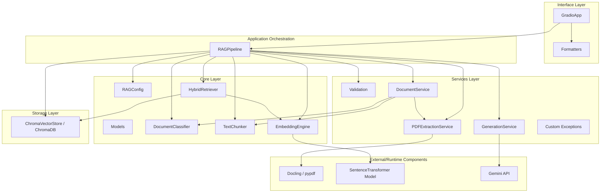
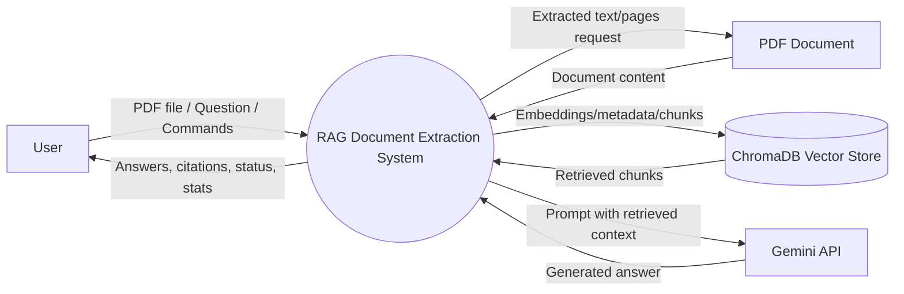

# Project Report
## Advanced AI-Powered Document Insights & Data Extraction (RAG Pipeline)

## 1. Title
**Advanced AI-Powered Document Insights & Data Extraction using a Modular Retrieval-Augmented Generation (RAG) Pipeline**

## 2. Abstract
This project refactors an existing notebook-based Retrieval-Augmented Generation (RAG) document extraction prototype into a modular, testable, and academically defensible MCA mini project. The system ingests PDF documents, extracts text using Docling with a pypdf fallback, performs deterministic document/page classification, chunks extracted content with metadata preservation, generates semantic embeddings using SentenceTransformers, stores vectors in a persistent ChromaDB collection, and answers user questions through hybrid retrieval (dense vector search + sparse TF-IDF search with weighted Reciprocal Rank Fusion) and Google Gemini-based grounded generation. A Gradio web interface provides document upload, question answering with source references, and database management. The implementation emphasizes modular architecture, configuration management, validation, logging, error handling, and automated testing.

## 3. Introduction
Organizations and students frequently work with unstructured PDF documents such as resumes, invoices, contracts, payslips, and reports. Extracting relevant information manually is time-consuming and error-prone. RAG systems address this by retrieving relevant document segments and using a language model to generate context-aware responses grounded in retrieved evidence.

The original repository contained a functional notebook-based RAG pipeline. This project transforms that prototype into a structured Python application using a `src` package layout, service-oriented modules, persistent storage, safer configuration, and automated tests suitable for academic evaluation and demonstration.

## 4. Problem Statement
The notebook implementation demonstrated core RAG functionality but had limitations for maintainability, extensibility, and assessment readiness, including:
- Monolithic notebook structure with tightly coupled logic and UI
- Colab-specific and hardcoded configuration patterns
- Destructive vector-store initialization behavior
- Limited validation, logging, and exception handling
- Outdated/inconsistent dependency usage in places
- Lack of an independent automated test suite and complete academic documentation

The problem addressed is to preserve the existing RAG capabilities while refactoring the system into a modular, reliable, and testable application with a professional project structure and complete MCA documentation.

## 5. Objectives
- Preserve the original RAG pipeline functionality and technical identity
- Refactor notebook logic into a modular layered Python package (`src/rag_pipeline`)
- Implement robust PDF extraction with Docling primary parsing and pypdf fallback
- Support deterministic document/page classification and metadata-preserving chunking
- Use SentenceTransformer embeddings and persistent ChromaDB vector storage
- Implement hybrid retrieval (dense + sparse TF-IDF) with weighted RRF ranking
- Integrate Google Gemini answer generation with grounded prompts and source references
- Provide a functional Gradio interface for upload, QA, and database management
- Add validation, logging, custom exceptions, and environment-based configuration
- Implement and execute automated tests; prepare complete academic documentation

## 6. Existing System
The existing system (`Final_Pipeline_Report.ipynb`) implemented an end-to-end RAG workflow in a notebook environment:
- Docling-based PDF extraction with PyPDF2 fallback
- Rule-based document classification (per-page/overall heuristics)
- Character-based chunking (800 size, 150 overlap)
- SentenceTransformer embeddings (`all-MiniLM-L6-v2`)
- ChromaDB storage and semantic vector retrieval
- TF-IDF/KNN-style keyword retrieval and hybrid retrieval
- Google Gemini-based answer generation
- Gradio UI for upload and question answering

### Limitations of the existing system
- Notebook-centric execution and limited modularity
- Global mutable state and tight UI-backend coupling
- Colab-oriented imports/configuration and hardcoded API key usage
- Collection reset behavior causing non-persistent/unsafe startup semantics
- Broad exception handling and limited user-facing error safety
- No independent pytest suite or complete MCA project documentation package

## 7. Proposed System
The proposed system is a modular RAG application with a layered architecture and clear separation of concerns:
- **Core layer:** configuration, models, classifier, chunker, embeddings, retriever, pipeline orchestration
- **Service layer:** extraction, document processing, generation, validation, custom exceptions
- **Storage layer:** persistent ChromaDB vector store adapter
- **Interface layer:** Gradio UI and response formatters
- **Utility layer:** centralized logging

Key improvements:
- Environment-driven configuration (`python-dotenv`, `.env.example`)
- Maintained Gemini SDK integration (`google-genai`)
- Persistent collection access via `get_or_create_collection` (no startup deletion)
- Safer file/question/config validation and custom exception hierarchy
- Testable components with dependency injection in the pipeline controller
- Automated pytest suite and comprehensive documentation

## 8. System Requirements

### Functional requirements
- Upload and process PDF documents
- Extract text and classify document/page types
- Chunk text and store embeddings in persistent vector storage
- Accept user questions and retrieve relevant chunks
- Generate grounded answers with source references
- Display database statistics and allow explicit database clearing

### Non-functional requirements
- Modularity and maintainability
- Input validation and secure handling of API keys/uploads
- Error handling without exposing raw tracebacks in UI
- Reproducible environment setup and testability
- Persistent storage across application restarts

## 9. Software Requirements
- **Programming language:** Python 3.10+
- **Libraries/frameworks:** Docling, pypdf, ChromaDB, SentenceTransformers, scikit-learn, NumPy, google-genai, Gradio, python-dotenv, pytest
- **Interface:** Web UI via Gradio
- **Storage:** ChromaDB persistent local storage
- **LLM API:** Google Gemini (via `google-genai`, API key required for generation)

## 10. Hardware Requirements
- **Minimum:** 8 GB RAM, dual-core CPU, 2+ GB free disk space (for dependencies, models, and vector data)
- **Recommended:** 16 GB RAM, modern multi-core CPU, SSD storage, stable internet connection (for Gemini API calls and initial dependency/model downloads)
- **GPU:** Not required (embedding inference configured for CPU by default)

## 11. System Architecture



## 12. Data Flow Diagram (Level 0)



## 13. Data Flow Diagram (Level 1)

```mermaid
flowchart TB
    U[User] --> UI[Gradio Interface]

    UI -->|Upload PDF| P1[1. Validate & Extract PDF]
    P1 -->|Validated path| P2[2. Classify & Chunk]
    P2 -->|Chunks| P3[3. Generate Embeddings]
    P3 -->|Embeddings + metadata| P4[4. Store in ChromaDB]
    P4 -->|Ingestion status/stats| UI

    UI -->|Question| P5[5. Retrieve Relevant Chunks]
    P4 -. persisted chunks .-> P5
    P5 -->|Dense + sparse candidates| P6[6. Hybrid Ranking (RRF)]
    P6 -->|Top context chunks| P7[7. Generate Grounded Answer]
    P7 -->|Prompt| GEM[Gemini API]
    GEM -->|Response| P7
    P7 -->|Answer + source references| UI

    UI -->|Stats/Clear request| P8[8. Manage Database]
    P8 <--> VDB[(ChromaDB Collection)]
    P4 --> VDB
    P5 --> VDB
```

## 14. Module Descriptions

| Module/Package | Description |
|---|---|
| `core/config.py` | Loads and validates application configuration from defaults and environment variables |
| `core/models.py` | Typed dataclasses for documents, pages, chunks, retrieval results, and pipeline outputs |
| `core/classifier.py` | Deterministic rule-based document/page classification |
| `core/chunker.py` | Boundary-aware text chunking with overlap and metadata preservation |
| `core/embeddings.py` | Lazy SentenceTransformer embedding generation and normalization |
| `core/retriever.py` | Dense retrieval, sparse TF-IDF retrieval, and weighted RRF hybrid fusion |
| `core/pipeline.py` | `RAGPipeline` orchestration for ingestion and question answering |
| `storage/vector_store.py` | Persistent ChromaDB operations (store/query/stats/delete/clear) |
| `services/extraction_service.py` | PDF extraction using Docling with pypdf fallback |
| `services/document_service.py` | Document-level processing (IDs, normalization, chunk preparation) |
| `services/generation_service.py` | Grounded Gemini prompt/response handling with retries and source packaging |
| `services/validation.py` | File and question validation utilities |
| `services/exceptions.py` | Custom application exception hierarchy |
| `utils/logger.py` | Centralized logging setup and logger access |
| `interface/formatters.py` | UI formatting helpers for status, answers, sources, and stats |
| `interface/gradio_app.py` | Gradio UI layout and backend callback integration |
| `main.py` / `run.py` | Application entry points for launching the UI |

## 15. Algorithms

### 15.1 Rule-based document classification
- Inputs: page/document text and filename hint
- Method: keyword-based deterministic rules for resume, invoice, payslip, contract, financial statement, and report; fallback to general
- Overall document type: aggregated from per-page classifications (most common specific type preferred in ties)

### 15.2 Boundary-aware chunking
- Inputs: extracted page text, chunk size (default 800), overlap (default 150)
- Steps: normalize/clean text, return no chunks for short/empty pages, create single chunk for short pages, otherwise iteratively select chunk boundaries preferring paragraph/sentence/whitespace breaks, enforce forward progress, and generate stable chunk IDs from document/page/index/content hash

### 15.3 Dense retrieval
- Encode query using `EmbeddingEngine`
- Query ChromaDB collection for nearest chunks
- Convert returned distances to similarity-like scores and map to `RetrievalResult` objects

### 15.4 Sparse retrieval (TF-IDF)
- Build or reuse an in-memory TF-IDF index from stored chunk texts (rebuild when collection contents change)
- Vectorize query and compute cosine similarity against chunk vectors
- Return top-k non-zero lexical matches (empty for OOV/zero-similarity queries)

### 15.5 Hybrid ranking (Weighted RRF)
- Combine dense and sparse ranked lists
- Deduplicate by chunk ID
- Compute score: \(RRF(d)=\sum_i \frac{w_i}{k + rank_i(d)}\) with defaults \(w_{dense}=0.6\), \(w_{sparse}=0.4\), \(k=60\)
- Sort by fused score (desc), stable tie-break by chunk ID, return top-k

### 15.6 Grounded answer generation
- Construct prompt containing retrieved source blocks (filename/page/type/relevance/content)
- Instruct model to answer only from provided context, cite `[Source N]`, and return an explicit insufficient-information response when evidence is missing
- Call Gemini via `google-genai` with bounded retries for transient/rate-limit failures

## 16. Database/Storage Design
- **Database:** ChromaDB (persistent local vector store)
- **Default path:** `./data/chroma_db`
- **Collection:** configurable name (`documents_collection` by default), accessed via `get_or_create_collection`
- **Stored entities:** chunk embeddings, chunk text documents, chunk IDs
- **Metadata:** document ID, filename, source path, page number, chunk index, document type, character count, and additional safe scalar metadata
- **Operations supported:** insert/add, query by embedding, fetch all records, count, delete by document, explicit clear
- **Persistence behavior:** data remains across restarts; sparse retrieval index is rebuilt on demand from persisted contents

## 17. Implementation Methodology
1. **Audit:** Reviewed notebook logic, identified reusable components and defects
2. **Architecture design:** Defined layered modules and ownership-aligned file structure
3. **Refactoring:** Extracted and adapted notebook logic into core/services/storage/interface modules
4. **Integration:** Implemented `RAGPipeline` orchestration and Gradio backend callbacks
5. **Hardening:** Added env-based config, validation, logging, custom exceptions, and persistence fixes
6. **Testing:** Implemented pytest suite with mocks/temporary data and executed tests
7. **Documentation:** Prepared README and academic documents (architecture, report, team members, viva)

## 18. Testing Methodology
Automated tests were implemented using `pytest` with isolated temporary paths and mocked dependencies where appropriate.

### Test areas
- **Classification:** resume/invoice/contract detection and general fallback
- **Chunking:** short/long/empty text behavior, overlap/multiple chunks, metadata preservation, invalid config validation
- **Retrieval:** hybrid fusion and deduplication, ranking/order, configurable top-k, empty/OOV query handling
- **Validation:** question validation, invalid/missing/non-PDF/empty/bad-signature/oversized file checks
- **Storage:** insert/query/stats, persistence across instances, duplicate handling, delete/clear, empty DB behavior (skipped if `chromadb` unavailable)
- **Pipeline:** successful ingestion and QA, extraction/storage/generation failures, missing-context response

### Test design considerations
- No real Gemini API key or internet access required
- Expensive/external components mocked in pipeline/retriever-focused tests
- Temporary directories used for config/log/storage paths

## 19. Results and Observations
### Implemented outcomes (verified in code)
- Modular `src/rag_pipeline` package with core/services/storage/interface/utils layers
- Functional ingestion flow: validation → extraction (Docling/pypdf fallback) → classification → chunking → embeddings → ChromaDB storage
- Functional QA flow: validation → retrieval (dense/sparse/hybrid RRF) → grounded Gemini generation with source references
- Gradio UI with upload, question answering (hybrid toggle, sources, retrieval details), and database management (stats, refresh, explicit clear confirmation)
- Environment-based configuration and documentation artifacts (`.env.example`, `requirements.txt`, `pyproject.toml`)

### Automated test execution (actual run in this environment)
- Command: `python -m pytest -q` (with `PYTHONPATH=src`)
- Result: **21 passed** (exit code 0)
- Additional note: `tests/test_storage.py` is skipped when `chromadb` is not installed (`pytest.importorskip("chromadb")`); in this environment `chromadb` was not available, so storage tests were skipped in a storage-only run.

### Observations
- Core logic (classification, chunking, validation, retriever fusion, pipeline orchestration with mocks) is verifiable without external APIs
- Full runtime functionality (embedding model download/load, ChromaDB persistence operations, Docling parsing, Gemini responses, Gradio UI serving) depends on installed dependencies and, for generation, a valid `GEMINI_API_KEY`
- Sparse TF-IDF retrieval is rebuilt from persisted ChromaDB contents when needed, preserving consistency across restarts without requiring a separate index persistence mechanism

## 20. Limitations
- OCR support is not claimed as a verified feature of the configured extraction pipeline; scanned/image-only PDFs may not yield usable text
- Answer quality depends on extraction quality, chunking/retrieval relevance, and Gemini model behavior/availability
- Gemini answer generation requires a valid API key and network access; without it, QA generation cannot be fully validated end-to-end
- Some runtime features (ChromaDB persistence behavior, Docling parsing, SentenceTransformer embeddings, Gradio UI) require environment dependencies that may not be present in all execution environments
- No quantitative accuracy/latency benchmark suite is included; performance metrics are not claimed

## 21. Future Scope
- Add OCR-capable extraction pipeline and evaluate performance on scanned PDFs
- Implement evaluation metrics (retrieval precision/recall, answer faithfulness) with labeled datasets
- Add authentication/multi-user document isolation and role-based access in UI
- Persist sparse retrieval indexes or optimize incremental indexing for large collections
- Support additional file formats and richer document structure extraction (tables/figures)
- Add asynchronous/background processing and progress streaming for large document ingestion
- Integrate observability dashboards and configurable model/provider abstractions

## 22. Conclusion
The project successfully refactors the original notebook-based RAG prototype into a modular, maintainable, and testable Python application suitable for an MCA mini project. Core RAG capabilities are preserved while improving architecture, configuration safety, persistence behavior, validation, logging, exception handling, and documentation. Automated tests verify key components and pipeline orchestration logic, and the resulting system provides a practical foundation for further enhancement and evaluation.

## 23. References
1. ChromaDB Documentation: https://docs.trychroma.com/
2. Sentence Transformers Documentation: https://www.sbert.net/
3. Docling Documentation: https://docling-project.github.io/docling/
4. pypdf Documentation: https://pypdf.readthedocs.io/
5. scikit-learn TfidfVectorizer and cosine similarity: https://scikit-learn.org/stable/
6. Google GenAI Python SDK: https://googleapis.github.io/python-genai/
7. Gradio Documentation: https://www.gradio.app/docs
8. pytest Documentation: https://docs.pytest.org/

## 24. Team Members

- Anshul
- Ravi
- Sarthak
- Jivika
